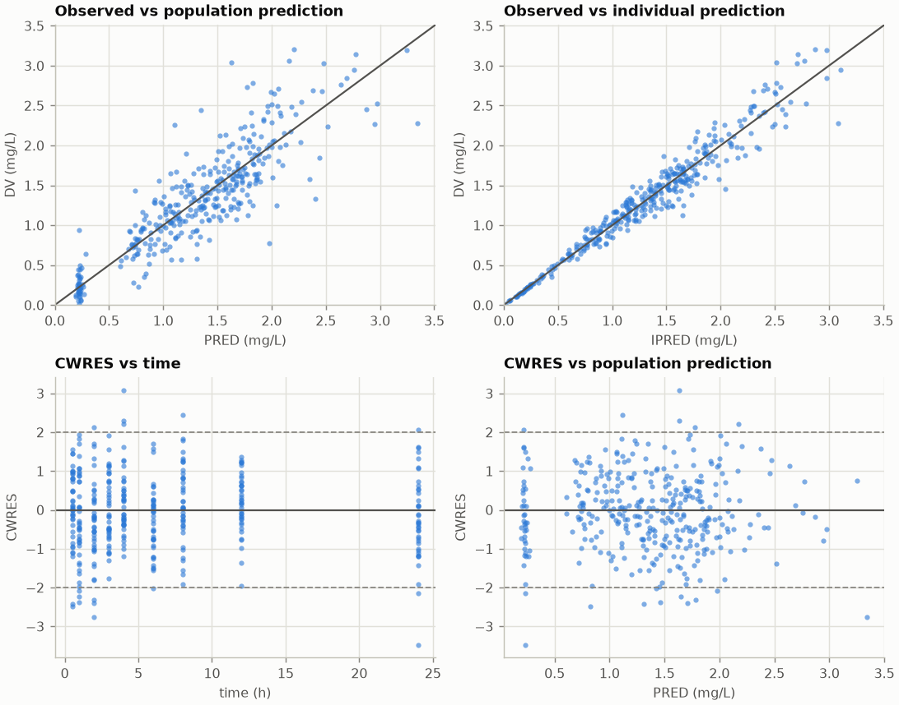
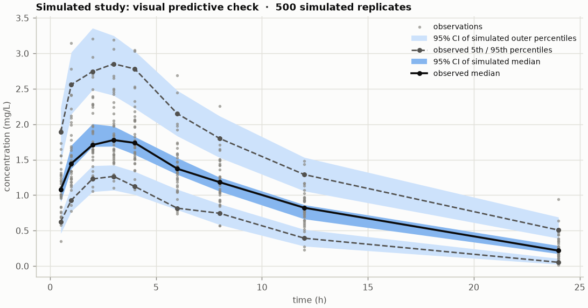
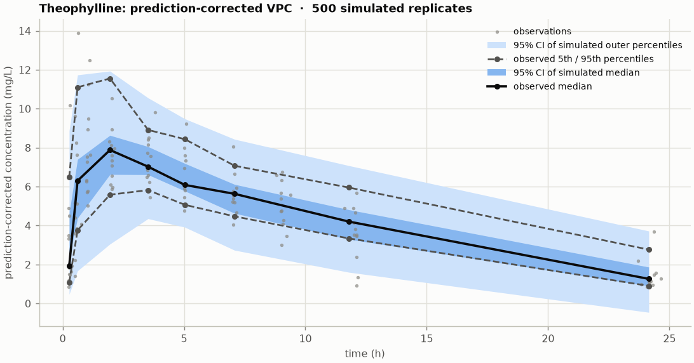
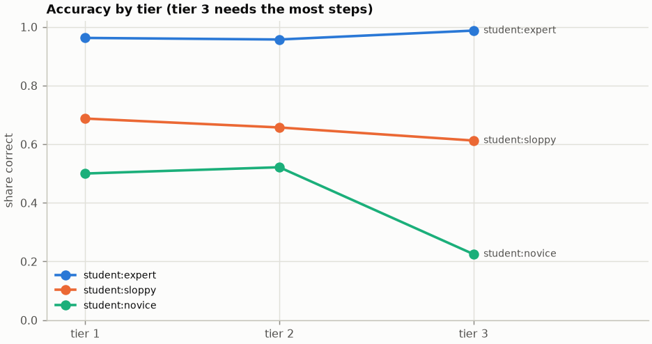

# pkforge

[](https://github.com/ryantravonmcdowell/pkforge/actions/workflows/ci.yml)


**A pharmacokinetics engine, and an LLM benchmark whose answers are computed rather than written.**

pkforge has two halves:

1. **A pharmacometrics engine.** Compartment models solved exactly, non-compartmental
   analysis, and population (nonlinear mixed-effects) estimation by **FOCE-I**, the method
   NONMEM made standard. It comes with a covariance step, CWRES, shrinkage and visual
   predictive checks.
2. **A reasoning benchmark built on that engine.** Pharmacokinetics problems are generated
   from a seed, every answer is re-derived by an independent simulation before it ships, and
   wrong answers are diagnosed: the grader knows what forgetting ln 2 or ignoring
   accumulation would have produced, and names the mistake when a model's number matches it.

Both halves exist for the same reason. Numerical answers in science are easy to state with
confidence and hard to check. Here every number is checked twice.

> Not for clinical use. This is research and teaching software.

## Quick start

```bash
git clone https://github.com/ryantravonmcdowell/pkforge.git
cd pkforge
python -m venv .venv
source .venv/bin/activate              # Windows: .venv\Scripts\activate
pip install -e ".[dev]"

pkforge demo                           # offline: simulate, NCA, FOCE-I fit, VPC, benchmark (~40 s)
pkforge theoph --weight --report theoph.html   # the classic theophylline data (downloads 3 kB)
```

`pkforge demo` writes `demo_output/fit_report.html` and `demo_output/bench_report.html`.

---

## Part 1: the engine

| Component | What it does |
|---|---|
| `models` | 1-, 2- and 3-compartment linear models; IV bolus, zero-order infusion and first-order oral absorption in any combination. Solved exactly as sums of exponentials, vectorised over subjects. |
| `ode` | Numerical ODE solution, used for saturable (Michaelis-Menten) elimination and as an independent check on `models`. |
| `nca` | Non-compartmental analysis: linear-up/log-down AUC, λz by adjusted R² with Cmax excluded after oral dosing, AUC∞, AUMC, MRT, CL(/F), Vz(/F), Vss, C0 back-extrapolation. |
| `estimation` | Population PK by FOCE-I: log-normal between-subject variability, power covariate models (e.g. allometric weight), additive, proportional or combined residual error, a covariance step, CWRES/IWRES, η-shrinkage, VPC and prediction-corrected VPC, and starting values derived from NCA. |
| `datasets` | Public data fetched on demand and pinned by SHA-256, never redistributed. |

Data use the NONMEM layout (`ID, TIME, EVID, AMT, RATE, CMT, DV` plus covariates):

```bash
pkforge simulate -o study.csv                       # a simulated 40-subject oral study
pkforge nca study.csv
pkforge fit study.csv --covariate CL:WT:70:0.75 --covariate V:WT:70:1 --report fit.html
```

### How the engine is validated

Scientific software is only as good as its checks, and each check below runs in CI:

| Check | Agreement |
|---|---|
| Exact solution vs ODE solver: 1, 2, 3 compartments, mixed routes, overlapping infusions | 10⁻⁶ relative |
| Two-compartment closed form vs eigendecomposition of the rate matrix | 10⁻⁸ |
| NCA on a monoexponential profile (AUC, λz, CL, MRT, Vss) | exact to 10⁻⁹ |
| FOCE-I objective vs the exact marginal likelihood of a linear-Gaussian model | 10⁻⁹ relative |
| FOCE-I vs numerical integration over η for a nonlinear model | within 0.1 OFV units |
| Steady-state trough vs the textbook accumulation formula | 10⁻⁹ |
| VPC flags a model whose clearance is wrong by 2.5x | coverage < 50%, against ≥ 80% for the true model |

### Result: recovering a known model

`pkforge demo` simulates 40 subjects (one 100 mg oral dose, 9 samples each, body weight
40–120 kg) from a known model, then fits it from starting values derived by NCA:

| Parameter | True | Estimate | RSE |
|---|---|---|---|
| CL (L/h at 70 kg) | 4.0 | 4.15 | 4.3% |
| V (L at 70 kg) | 40 | 40.2 | 2.9% |
| KA (1/h) | 1.2 | 1.15 | 5.9% |
| ω² CL | 0.09 | 0.071 | 23% |
| ω² V | 0.04 | 0.028 | 26% |
| ω² KA | 0.16 | 0.112 | 28% |
| σ proportional | 0.12 | 0.115 | 4.6% |

The fixed effects and the residual error land within about one standard error of the truth.
The three variance terms fall 1.2–1.6 standard errors below their true values. That is
within sampling error for 40 subjects, but the shared direction is consistent with the known
downward bias of maximum-likelihood variance estimates in small samples.





### Result: real data

The theophylline dataset (12 subjects, one oral dose, 24 h of sampling) is the classic test
for population PK software. It is downloaded from the
[Rdatasets](https://vincentarelbundock.github.io/Rdatasets/) mirror of R's `datasets`
package and verified by checksum. Fitted with a one-compartment model, combined residual
error and allometric weight scaling:

| Parameter | Estimate | RSE | Between-subject CV |
|---|---|---|---|
| CL | 2.80 L/h at 70 kg (0.040 L/h/kg) | 8.1% | 26% |
| V | 32.2 L at 70 kg (0.46 L/kg) | 4.6% | 13% |
| KA | 1.55 /h | 20% | 73% |

The residual error is 0.59 mg/L additive plus 7.4% proportional. Adding weight scaling lowers
the OFV only from 121.47 to 120.13, with no extra estimated parameters. With twelve subjects
of similar weight, the data cannot say whether weight matters. The fit converges to the same
optimum from NCA-derived and from hand-chosen starting values.



---

## Part 2: the benchmark

LLM benchmarks in quantitative science have two problems. Fixed answer keys leak into
training data, and pass/fail grading says nothing about *why* a model failed. pkforge
addresses both:

- **Contamination-resistant.** Problems are generated from a seed. A new seed gives
  instances nobody has seen, and every generated file carries a canary string so leaks can be
  detected.
- **Self-verifying.** Each answer comes from the textbook formula and is then recomputed
  independently by the engine: simulation to steady state, ODE integration, root-finding or
  NCA. A problem whose two values disagree is never emitted. The test suite plants a wrong
  formula and checks that it is caught.
- **Diagnostic.** For each problem the generator also computes what each known mistake
  produces. A wrong answer that matches one is labelled with that misconception, not just
  "incorrect".
- **Unit-aware.** "4.2 mg/L", "4.2 µg/mL", "4200 ng/mL" and "0.42 mg/dL" are all graded as
  the same answer. The right number with the wrong power of ten is labelled a unit error.

### Problem families

| Tier | Family | Mistakes it can diagnose |
|---|---|---|
| 1 | half-life from CL and V | forgot ln 2, inverted ratio, used log10 2 |
| 1 | concentration after an IV bolus | forgot ln 2, linear decline, whole half-lives only, ignored elimination |
| 1 | infusion steady state | used volume, multiplied by clearance, divided by k |
| 1 | IV loading dose | used clearance, divided by volume |
| 2 | time to fall to a threshold | forgot ln 2, linear decline, used log10 |
| 2 | average oral steady state | forgot F, divided by F, used volume |
| 2 | steady-state trough | forgot accumulation, gave the peak, gave the average |
| 2 | accumulation ratio | forgot ln 2, inverted |
| 2 | AUC from a table (trapezoidal rule) | rectangle rules, skipped first interval, log rule |
| 2 | terminal half-life from two samples | forgot ln 2, linear halving, mixed log bases |
| 2 | time to a fraction of steady state | forgot ln 2, used log10, fraction × half-life |
| 3 | oral Tmax | sum in denominator, 1/ka, absorption half-life |
| 3 | oral Cmax | IV peak, ignored bioavailability |
| 3 | Michaelis-Menten daily dose | linear clearance, swapped Km and C, Vmax only |
| 3 | two-compartment terminal half-life | central or total volume shortcut, α-phase |

A generated problem, as `pkforge bench show` prints it:

```text
A drug is given as a 1000 mg IV bolus every 8 h. Its clearance is 12 L/h and its volume of
distribution is 250 L (one-compartment, first-order elimination). What is the trough
concentration at steady state, just before a dose, in mg/L?

answer: 8.54435 mg/L   (engine check: 8.54435)
  if average instead of trough: 10.4167 mg/L
  if forgot accumulation: 2.72453 mg/L
  if peak instead of trough: 12.5444 mg/L
```

### Showing the grader works

Before trusting a grader on real models, check it on test-takers whose mistakes are known.
`pkforge demo` runs three **simulated students** with programmed error rates through 300
problems:

| Student | Accuracy (95% CI) | Misconception rate | Unit errors |
|---|---|---|---|
| expert | 96.7% (94.0–98.2) | 1.7% | 0% |
| sloppy | 65.3% (59.8–70.5) | 9.0% | 17.7% |
| novice | 43.7% (38.2–49.3) | 46.3% | 2.3% |

The novice is programmed to use a wrong method about 45% of the time, rising with tier, and
the grader measured 46.3%. The sloppy student slips a factor of 1000 in 15% of answers, plus
a few that had no misconception to fall back on, and the grader measured 17.7%. These rows
describe simulators, not real models; they show the measurement works.



### Evaluating real models

```bash
pip install -e ".[anthropic]"
export ANTHROPIC_API_KEY=...            # or: ant auth login
pkforge bench generate --n 300 --seed 2026 -o problems.jsonl
pkforge bench run --problems problems.jsonl --model anthropic:claude-opus-5-5 \
                  --model openai:<model-name>
pkforge bench report -o bench_report.html
```

| Spec | Backend |
|---|---|
| `student:expert`, `student:sloppy`, `student:novice` | simulated test-takers |
| `openai:<model>` | any OpenAI-compatible server; set `OPENAI_BASE_URL` for a self-hosted one |
| `anthropic:<model>[@effort]` | Claude via the official SDK, e.g. `anthropic:claude-opus-5-5@low` |

The report has accuracy with Wilson intervals, exact McNemar tests between models on the
same questions, a breakdown of outcome labels, the misconceptions each model fell into, and
per-family accuracy. Runs are stored in SQLite and resume after an interruption. The Claude
adapter never falls back to a different model, because an answer must be graded under the
name of the model that wrote it.

---

## Project layout

```text
src/pkforge/
├── dosing.py              doses, subjects, NONMEM-style datasets
├── models.py              exact linear compartment models (batched)
├── ode.py                 ODE solutions, incl. Michaelis-Menten elimination
├── nca.py                 non-compartmental analysis
├── estimation/
│   ├── laplace.py         FOCE-I objective and conditional-mode search (model-agnostic)
│   ├── population.py      population models, FOCE-I fit, covariance step, diagnostics
│   ├── vpc.py             VPC and prediction-corrected VPC
│   ├── initial.py         starting values from NCA
│   └── error.py           residual error models
├── datasets.py            checksum-pinned public data
├── bench/
│   ├── families.py        15 problem families: solve, verify, distractors
│   ├── problems.py        generation, verification, JSONL with a canary
│   ├── units.py           unit parsing and conversion
│   ├── grading.py         answer extraction and diagnosis
│   ├── adapters.py        simulated students, OpenAI-compatible, Claude
│   ├── runner.py          concurrent, resumable runs in SQLite
│   └── analysis.py        Wilson intervals, McNemar tests, misconception tables
├── plots.py, report.py    figures and self-contained HTML reports
└── cli.py                 `pkforge` command
```

## Development

```bash
pytest                       # 145 tests, about a minute (population fits included)
pytest -m "not slow"         # skip the population fits
ruff check src tests
python scripts/make_figures.py   # regenerate the README figures
```

CI runs lint, the tests, the demo and the theophylline fit on Python 3.10–3.13, and builds
and runs the Docker image (`docker build -t pkforge . && docker run --rm pkforge`).

## Limitations

- **Speed.** FOCE-I here uses finite-difference derivatives in NumPy: about 20 seconds for 40
  subjects and 7 parameters. NONMEM and nlmixr2 are much faster.
- **Scope of the population models.** Linear models only (saturable elimination is available
  for simulation, not estimation), diagonal Ω, fixed covariate exponents, no handling of
  censored data below the limit of quantification, no inter-occasion variability.
- **What the benchmark measures.** It grades final numbers, not reasoning, and it can name
  only the mistakes it anticipates; any other wrong answer is labelled `incorrect`. The 2%
  tolerance rewards answers given to the three significant figures the prompt asks for.

## License

MIT, see [LICENSE](LICENSE). The theophylline data are not included; they are downloaded
from their public source when used.
